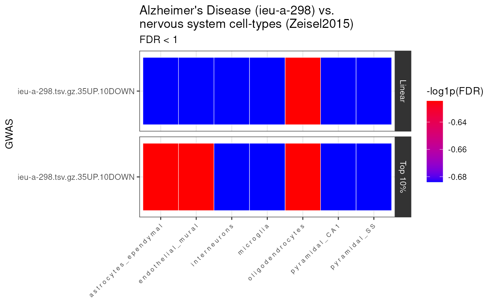
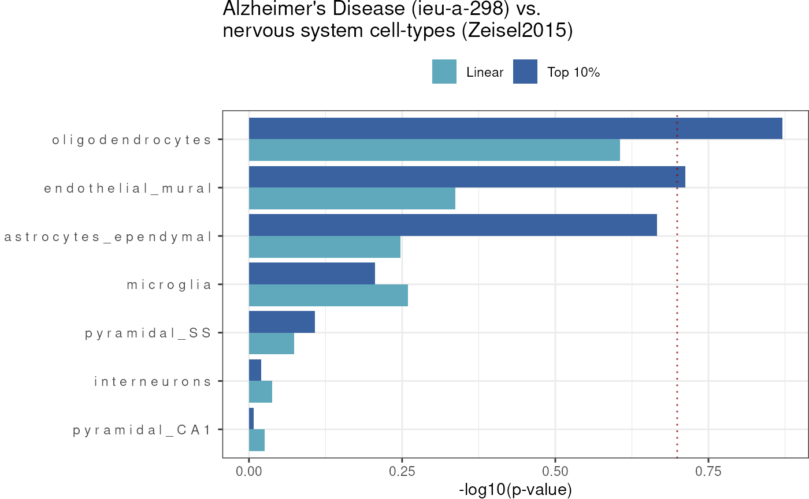

# Getting started

``` r

library(MAGMA.Celltyping) 
library(dplyr)
```

## Intro

`MAGMA.Celltyping` is a software package that facilitates conducting
cell-type-specific enrichment tests on GWAS summary statistics.

## Setup

Specify where you want the large files to be downloaded to.

*NOTE*: Make sure you change `storage_dir` to somewhere other than
[`tempdir()`](https://rdrr.io/r/base/tempfile.html) if you want to make
sure the results aren’t deleted after this R session closes!

``` r

storage_dir <- tempdir()
```

## Prepare data

### GWAS

- We need to have a summary statistics file to analyse as input.  
- As an example, you can download UK Biobank summary statistics for
  ‘fluid_intelligence’ using
  [`get_example_gwas()`](https://neurogenomics.github.io/MAGMA_Celltyping/reference/get_example_gwas.md).

Here we provide a pre-munged version of the above file.

#### Munging

Our lab have created
[`MungeSumstats`](https://github.com/neurogenomics/MungeSumstats), a
robust Bioconductor package for formatting multiple types of summary
statistics files. We highly recommend processing your GWAS summary
statistics with `MungeSumstats` before continuing. See the
*full_workflow* vignette for more details.

The minimum info needed *after* munging is:  
- “SNP”, “CHR”, and “BP” as first three columns. - It has at least one
of these columns: “Z”,“OR”,“BETA”,“LOG_ODDS”,“SIGNED_SUMSTAT”

``` r

path_formatted <- MAGMA.Celltyping::get_example_gwas(
  trait = "prospective_memory")
```

#### Map SNPs to Genes

Note you can input the genome build of your summary statistics for this
step or it can be inferred if left `NULL`:

``` r

genesOutPath <- MAGMA.Celltyping::map_snps_to_genes(
  path_formatted = path_formatted,
  genome_build = "GRCh37")
```

#### MAGMA_Files_Public

Rather than preprocessing the GWAS yourself, you can instead use the
[`MAGMA_Files_Public`](https://github.com/neurogenomics/MAGMA_Files_Public)
database we have created. It contains pre-computed MAGMA SNP-to-genes
mapping files for hundreds of GWAS.

You can browse which GWAS traits are available by looking at the
provided
[*metadata.csv*](https://github.com/neurogenomics/MAGMA_Files_Public/blob/master/metadata.csv)
file.

``` r

magma_dirs <- MAGMA.Celltyping::import_magma_files(ids = "ieu-a-298")
```

    ## Using built-in example files: ieu-a-298.tsv.gz.35UP.10DOWN

    ## Returning MAGMA directories.

### CellTypeDataset

`ewceData` provides a number of CellTypeDatasets (CTD) to be used a
cell-type transcriptomic signature reference files.

If you want to create your own single-cell transcriptomic reference,
you’ll need to first convert it to CTD using the instructions found in
the `EWCE` package [documentation
here](https://github.com/NathanSkene/EWCE/).

``` r

ctd <- ewceData::ctd()
```

    ## see ?ewceData and browseVignettes('ewceData') for documentation

    ## loading from cache

Note that the cell type dataset loaded in the code above is the
Karolinksa cortex/hippocampus data only. For the full Karolinska dataset
with hypothalamus and midbrain instead use the following:

    ctd <- MAGMA.Celltyping::get_ctd("ctd_allKI")

Or for the DRONC seq or AIBS datasets use:

    ctd <- get_ctd("ctd_Tasic")
    ctd <- get_ctd("ctd_DivSeq")
    ctd <- get_ctd("ctd_AIBS")
    ctd <- get_ctd("ctd_DRONC_human")
    ctd <- get_ctd("ctd_DRONC_mouse")
    ctd <- get_ctd("ctd_BlueLake2018_FrontalCortexOnly")
    ctd <- get_ctd("ctd_BlueLake2018_VisualCortexOnly")
    ctd <- get_ctd("ctd_Saunders")

## Run cell-type enrichment analyses

`MAGMA.Celltyping` offers a suite of functions for conducting various
types of cell-type-specific enrichment tests on GWAS summary statistics.

The `celltype_associations_pipeline` wraps several functions that in
previous versions of `MAGMA.Celltyping` had to be set up and run
separately. These include:

- **Linear enrichment**:
  `calculate_celltype_associations(EnrichmentMode = "linear")`
  internally. Activated when `run_linear=TRUE`.
- **Top 10% enrichment**: Uses
  `calculate_celltype_associations(EnrichmentMode = "Top 10%")`
  internally. Activated when `run_top10=TRUE`.
- **Conditional enrichment**: Uses
  `calculate_conditional_celltype_associations` internally. Activated
  when `run_conditional=TRUE`.

Thus, `celltype_associations_pipeline` is designed to make these
analyses easier to run.

``` r

MAGMA_results <- MAGMA.Celltyping::celltype_associations_pipeline(
  magma_dirs = magma_dirs,
  ctd = ctd,
  ctd_species = "mouse", 
  ctd_name = "Zeisel2015", 
  run_linear = TRUE, 
  run_top10 = TRUE)
```

We’ve also saved a pre-computed version of these results as a dataset:

``` r

MAGMA_results <- MAGMA.Celltyping::enrichment_results
```

## Plot results

### Merge results

`merge_results` imports each of the MAGMA enrichment results files and
merges them into one so that they can easily be plotted and further
analysed.

``` r

merged_results <- MAGMA.Celltyping::merge_results(
  MAGMA_results = MAGMA_results)
```

    ## Saving full merged results to ==> /tmp/RtmpiTiKA6/MAGMA_celltyping./.lvl1.csv

``` r

knitr::kable(merged_results)
```

| GWAS | Celltype | TYPE | OBS_GENES | BETA | BETA_STD | SE | P | log10p | level | Method | EnrichmentMode | GCOV_FILE | CONTROL | CONTROL_label | genesOutCOND | analysis_name | FDR | Celltype_id |
|:---|:---|:---|:---|---:|---:|---:|---:|---:|---:|:---|:---|:---|:---|:---|:---|:---|---:|:---|
| ieu-a-298.tsv.gz.35UP.10DOWN | o l i g o d e n d r o c y t e s | COVAR | 962 | 0.0016776 | 0.0199640 | 0.0024613 | 0.24785 | -0.6058111 | 1 | MAGMA | Linear | ieu-a-298.tsv.gz.35UP.10DOWN.level1.Zeisel2015_linear.gsa.out | BASELINE | BASELINE | NA | Zeisel2015_linear | 0.867475 | oligodendrocytes |
| ieu-a-298.tsv.gz.35UP.10DOWN | a s t r o c y t e s \_ e p e n d y m a l | SET | 104 | 0.0671670 | 0.0178860 | 0.0853000 | 0.21562 | -0.6663110 | 1 | MAGMA | Top 10% | ieu-a-298.tsv.gz.35UP.10DOWN.level1.Zeisel2015_top10.gsa.out | BASELINE | BASELINE | NA | Zeisel2015_top10 | 0.867475 | astrocytes_ependymal |
| ieu-a-298.tsv.gz.35UP.10DOWN | e n d o t h e l i a l \_ m u r a l | SET | 98 | 0.0831670 | 0.0215500 | 0.0962320 | 0.19384 | -0.7125566 | 1 | MAGMA | Top 10% | ieu-a-298.tsv.gz.35UP.10DOWN.level1.Zeisel2015_top10.gsa.out | BASELINE | BASELINE | NA | Zeisel2015_top10 | 0.867475 | endothelial_mural |
| ieu-a-298.tsv.gz.35UP.10DOWN | o l i g o d e n d r o c y t e s | SET | 94 | 0.1124000 | 0.0285690 | 0.1017200 | 0.13472 | -0.8705679 | 1 | MAGMA | Top 10% | ieu-a-298.tsv.gz.35UP.10DOWN.level1.Zeisel2015_top10.gsa.out | BASELINE | BASELINE | NA | Zeisel2015_top10 | 0.867475 | oligodendrocytes |
| ieu-a-298.tsv.gz.35UP.10DOWN | a s t r o c y t e s \_ e p e n d y m a l | COVAR | 962 | -0.0003729 | -0.0045268 | 0.0022566 | 0.56561 | -0.2474829 | 1 | MAGMA | Linear | ieu-a-298.tsv.gz.35UP.10DOWN.level1.Zeisel2015_linear.gsa.out | BASELINE | BASELINE | NA | Zeisel2015_linear | 0.981580 | astrocytes_ependymal |
| ieu-a-298.tsv.gz.35UP.10DOWN | e n d o t h e l i a l \_ m u r a l | COVAR | 962 | 0.0002391 | 0.0029144 | 0.0023811 | 0.46002 | -0.3372233 | 1 | MAGMA | Linear | ieu-a-298.tsv.gz.35UP.10DOWN.level1.Zeisel2015_linear.gsa.out | BASELINE | BASELINE | NA | Zeisel2015_linear | 0.981580 | endothelial_mural |
| ieu-a-298.tsv.gz.35UP.10DOWN | i n t e r n e u r o n s | COVAR | 962 | -0.0033333 | -0.0393200 | 0.0024009 | 0.91728 | -0.0374981 | 1 | MAGMA | Linear | ieu-a-298.tsv.gz.35UP.10DOWN.level1.Zeisel2015_linear.gsa.out | BASELINE | BASELINE | NA | Zeisel2015_linear | 0.981580 | interneurons |
| ieu-a-298.tsv.gz.35UP.10DOWN | m i c r o g l i a | COVAR | 962 | -0.0002839 | -0.0036131 | 0.0022446 | 0.55030 | -0.2594005 | 1 | MAGMA | Linear | ieu-a-298.tsv.gz.35UP.10DOWN.level1.Zeisel2015_linear.gsa.out | BASELINE | BASELINE | NA | Zeisel2015_linear | 0.981580 | microglia |
| ieu-a-298.tsv.gz.35UP.10DOWN | p y r a m i d a l \_ C A 1 | COVAR | 962 | -0.0037493 | -0.0440450 | 0.0023802 | 0.94218 | -0.0258661 | 1 | MAGMA | Linear | ieu-a-298.tsv.gz.35UP.10DOWN.level1.Zeisel2015_linear.gsa.out | BASELINE | BASELINE | NA | Zeisel2015_linear | 0.981580 | pyramidal_CA1 |
| ieu-a-298.tsv.gz.35UP.10DOWN | p y r a m i d a l \_ S S | COVAR | 962 | -0.0023657 | -0.0282810 | 0.0023306 | 0.84480 | -0.0732461 | 1 | MAGMA | Linear | ieu-a-298.tsv.gz.35UP.10DOWN.level1.Zeisel2015_linear.gsa.out | BASELINE | BASELINE | NA | Zeisel2015_linear | 0.981580 | pyramidal_SS |
| ieu-a-298.tsv.gz.35UP.10DOWN | i n t e r n e u r o n s | SET | 106 | -0.1554800 | -0.0417660 | 0.0911160 | 0.95587 | -0.0196012 | 1 | MAGMA | Top 10% | ieu-a-298.tsv.gz.35UP.10DOWN.level1.Zeisel2015_top10.gsa.out | BASELINE | BASELINE | NA | Zeisel2015_top10 | 0.981580 | interneurons |
| ieu-a-298.tsv.gz.35UP.10DOWN | m i c r o g l i a | SET | 91 | -0.0341170 | -0.0085425 | 0.1093000 | 0.62250 | -0.2058606 | 1 | MAGMA | Top 10% | ieu-a-298.tsv.gz.35UP.10DOWN.level1.Zeisel2015_top10.gsa.out | BASELINE | BASELINE | NA | Zeisel2015_top10 | 0.981580 | microglia |
| ieu-a-298.tsv.gz.35UP.10DOWN | p y r a m i d a l \_ C A 1 | SET | 111 | -0.1930200 | -0.0529550 | 0.0923320 | 0.98158 | -0.0080743 | 1 | MAGMA | Top 10% | ieu-a-298.tsv.gz.35UP.10DOWN.level1.Zeisel2015_top10.gsa.out | BASELINE | BASELINE | NA | Zeisel2015_top10 | 0.981580 | pyramidal_CA1 |
| ieu-a-298.tsv.gz.35UP.10DOWN | p y r a m i d a l \_ S S | SET | 98 | -0.0750110 | -0.0194370 | 0.0965900 | 0.78120 | -0.1072378 | 1 | MAGMA | Top 10% | ieu-a-298.tsv.gz.35UP.10DOWN.level1.Zeisel2015_top10.gsa.out | BASELINE | BASELINE | NA | Zeisel2015_top10 | 0.981580 | pyramidal_SS |

### Heatmap

Now we’ll construct a heatmap visualizing the enrichment results, such
that each GWAS is shown on the y-axis and each cell-type is shown on the
x-axis. Results can be further facetted by what kind of test was run
(linear, top10%, and/or conditional).

``` r

heat <- MAGMA.Celltyping::results_heatmap(
  merged_results = merged_results, 
  title = "Alzheimer's Disease (ieu-a-298) vs.\nnervous system cell-types (Zeisel2015)",
  fdr_thresh = 1)
```

    ## 14 results @ FDR < 1



### Bar plot

Now we can also plot the p-value results (-log10 p-values) based on a
significance threshold (for either linear and top10%) together in a bar
plot (sorted by top10% results).

``` r

barplot_ggplot <- MAGMA.Celltyping::results_barplot(
  merged_results = merged_results,
  title="Alzheimer's Disease (ieu-a-298) vs.\nnervous system cell-types (Zeisel2015)",
  fdr_thresh = 1,
  horz_line_p = .2
)
```

    ## 14 results @ FDR < 1



## Top results

### Top phenotypes

Get the phenotypes with the greatest number of significant cell-type
enrichment results.

``` r

top_phenos <- merged_results %>% 
  dplyr::group_by(EnrichmentMode, GWAS) %>%
  dplyr::summarise(Celltype=dplyr::n_distinct(Celltype)) %>%
  dplyr::arrange(dplyr::desc(Celltype))
```

    ## `summarise()` has grouped output by 'EnrichmentMode'. You can override using
    ## the `.groups` argument.

``` r

knitr::kable(top_phenos)
```

| EnrichmentMode | GWAS                         | Celltype |
|:---------------|:-----------------------------|---------:|
| Linear         | ieu-a-298.tsv.gz.35UP.10DOWN |        7 |
| Top 10%        | ieu-a-298.tsv.gz.35UP.10DOWN |        7 |

### Top enrichments

Get the phenotypes-celltype enrichment results with the most significant
p-values (per phenotype).

``` r

top_enrich <- merged_results %>% 
  dplyr::group_by(EnrichmentMode, GWAS) %>%
  dplyr::slice_min(FDR, n = 2)
knitr::kable(top_enrich) 
```

| GWAS | Celltype | TYPE | OBS_GENES | BETA | BETA_STD | SE | P | log10p | level | Method | EnrichmentMode | GCOV_FILE | CONTROL | CONTROL_label | genesOutCOND | analysis_name | FDR | Celltype_id |
|:---|:---|:---|:---|---:|---:|---:|---:|---:|---:|:---|:---|:---|:---|:---|:---|:---|---:|:---|
| ieu-a-298.tsv.gz.35UP.10DOWN | o l i g o d e n d r o c y t e s | COVAR | 962 | 0.0016776 | 0.0199640 | 0.0024613 | 0.24785 | -0.6058111 | 1 | MAGMA | Linear | ieu-a-298.tsv.gz.35UP.10DOWN.level1.Zeisel2015_linear.gsa.out | BASELINE | BASELINE | NA | Zeisel2015_linear | 0.867475 | oligodendrocytes |
| ieu-a-298.tsv.gz.35UP.10DOWN | a s t r o c y t e s \_ e p e n d y m a l | COVAR | 962 | -0.0003729 | -0.0045268 | 0.0022566 | 0.56561 | -0.2474829 | 1 | MAGMA | Linear | ieu-a-298.tsv.gz.35UP.10DOWN.level1.Zeisel2015_linear.gsa.out | BASELINE | BASELINE | NA | Zeisel2015_linear | 0.981580 | astrocytes_ependymal |
| ieu-a-298.tsv.gz.35UP.10DOWN | e n d o t h e l i a l \_ m u r a l | COVAR | 962 | 0.0002391 | 0.0029144 | 0.0023811 | 0.46002 | -0.3372233 | 1 | MAGMA | Linear | ieu-a-298.tsv.gz.35UP.10DOWN.level1.Zeisel2015_linear.gsa.out | BASELINE | BASELINE | NA | Zeisel2015_linear | 0.981580 | endothelial_mural |
| ieu-a-298.tsv.gz.35UP.10DOWN | i n t e r n e u r o n s | COVAR | 962 | -0.0033333 | -0.0393200 | 0.0024009 | 0.91728 | -0.0374981 | 1 | MAGMA | Linear | ieu-a-298.tsv.gz.35UP.10DOWN.level1.Zeisel2015_linear.gsa.out | BASELINE | BASELINE | NA | Zeisel2015_linear | 0.981580 | interneurons |
| ieu-a-298.tsv.gz.35UP.10DOWN | m i c r o g l i a | COVAR | 962 | -0.0002839 | -0.0036131 | 0.0022446 | 0.55030 | -0.2594005 | 1 | MAGMA | Linear | ieu-a-298.tsv.gz.35UP.10DOWN.level1.Zeisel2015_linear.gsa.out | BASELINE | BASELINE | NA | Zeisel2015_linear | 0.981580 | microglia |
| ieu-a-298.tsv.gz.35UP.10DOWN | p y r a m i d a l \_ C A 1 | COVAR | 962 | -0.0037493 | -0.0440450 | 0.0023802 | 0.94218 | -0.0258661 | 1 | MAGMA | Linear | ieu-a-298.tsv.gz.35UP.10DOWN.level1.Zeisel2015_linear.gsa.out | BASELINE | BASELINE | NA | Zeisel2015_linear | 0.981580 | pyramidal_CA1 |
| ieu-a-298.tsv.gz.35UP.10DOWN | p y r a m i d a l \_ S S | COVAR | 962 | -0.0023657 | -0.0282810 | 0.0023306 | 0.84480 | -0.0732461 | 1 | MAGMA | Linear | ieu-a-298.tsv.gz.35UP.10DOWN.level1.Zeisel2015_linear.gsa.out | BASELINE | BASELINE | NA | Zeisel2015_linear | 0.981580 | pyramidal_SS |
| ieu-a-298.tsv.gz.35UP.10DOWN | a s t r o c y t e s \_ e p e n d y m a l | SET | 104 | 0.0671670 | 0.0178860 | 0.0853000 | 0.21562 | -0.6663110 | 1 | MAGMA | Top 10% | ieu-a-298.tsv.gz.35UP.10DOWN.level1.Zeisel2015_top10.gsa.out | BASELINE | BASELINE | NA | Zeisel2015_top10 | 0.867475 | astrocytes_ependymal |
| ieu-a-298.tsv.gz.35UP.10DOWN | e n d o t h e l i a l \_ m u r a l | SET | 98 | 0.0831670 | 0.0215500 | 0.0962320 | 0.19384 | -0.7125566 | 1 | MAGMA | Top 10% | ieu-a-298.tsv.gz.35UP.10DOWN.level1.Zeisel2015_top10.gsa.out | BASELINE | BASELINE | NA | Zeisel2015_top10 | 0.867475 | endothelial_mural |
| ieu-a-298.tsv.gz.35UP.10DOWN | o l i g o d e n d r o c y t e s | SET | 94 | 0.1124000 | 0.0285690 | 0.1017200 | 0.13472 | -0.8705679 | 1 | MAGMA | Top 10% | ieu-a-298.tsv.gz.35UP.10DOWN.level1.Zeisel2015_top10.gsa.out | BASELINE | BASELINE | NA | Zeisel2015_top10 | 0.867475 | oligodendrocytes |

## Session Info

``` r

utils::sessionInfo()
```

    ## R Under development (unstable) (2026-01-25 r89330)
    ## Platform: x86_64-pc-linux-gnu
    ## Running under: Ubuntu 24.04.3 LTS
    ## 
    ## Matrix products: default
    ## BLAS:   /usr/lib/x86_64-linux-gnu/openblas-pthread/libblas.so.3 
    ## LAPACK: /usr/lib/x86_64-linux-gnu/openblas-pthread/libopenblasp-r0.3.26.so;  LAPACK version 3.12.0
    ## 
    ## locale:
    ##  [1] LC_CTYPE=en_US.UTF-8       LC_NUMERIC=C              
    ##  [3] LC_TIME=en_US.UTF-8        LC_COLLATE=en_US.UTF-8    
    ##  [5] LC_MONETARY=en_US.UTF-8    LC_MESSAGES=en_US.UTF-8   
    ##  [7] LC_PAPER=en_US.UTF-8       LC_NAME=C                 
    ##  [9] LC_ADDRESS=C               LC_TELEPHONE=C            
    ## [11] LC_MEASUREMENT=en_US.UTF-8 LC_IDENTIFICATION=C       
    ## 
    ## time zone: UTC
    ## tzcode source: system (glibc)
    ## 
    ## attached base packages:
    ## [1] stats     graphics  grDevices utils     datasets  methods   base     
    ## 
    ## other attached packages:
    ##  [1] ewceData_1.19.0         ExperimentHub_3.1.0     AnnotationHub_4.1.0    
    ##  [4] BiocFileCache_3.1.0     dbplyr_2.5.1            BiocGenerics_0.57.0    
    ##  [7] generics_0.1.4          dplyr_1.1.4             MAGMA.Celltyping_2.0.16
    ## [10] BiocStyle_2.39.0       
    ## 
    ## loaded via a namespace (and not attached):
    ##   [1] splines_4.6.0               BiocIO_1.21.0              
    ##   [3] bitops_1.0-9                ggplotify_0.1.3            
    ##   [5] filelock_1.0.3              tibble_3.3.1               
    ##   [7] R.oo_1.27.1                 XML_3.99-0.20              
    ##   [9] lifecycle_1.0.5             httr2_1.2.2                
    ##  [11] Rdpack_2.6.5                rstatix_0.7.3              
    ##  [13] lattice_0.22-7              MASS_7.3-65                
    ##  [15] backports_1.5.0             magrittr_2.0.4             
    ##  [17] limma_3.67.0                plotly_4.12.0              
    ##  [19] sass_0.4.10                 rmarkdown_2.30             
    ##  [21] jquerylib_0.1.4             yaml_2.3.12                
    ##  [23] otel_0.2.0                  HGNChelper_0.8.15          
    ##  [25] minqa_1.2.8                 DBI_1.2.3                  
    ##  [27] RColorBrewer_1.1-3          abind_1.4-8                
    ##  [29] GenomicRanges_1.63.1        purrr_1.2.1                
    ##  [31] R.utils_2.13.0              RCurl_1.98-1.17            
    ##  [33] yulab.utils_0.2.3           VariantAnnotation_1.57.1   
    ##  [35] rappdirs_0.3.4              gdtools_0.4.4              
    ##  [37] IRanges_2.45.0              S4Vectors_0.49.0           
    ##  [39] tidytree_0.4.7              pkgdown_2.2.0              
    ##  [41] codetools_0.2-20            DelayedArray_0.37.0        
    ##  [43] tidyselect_1.2.1            aplot_0.2.9                
    ##  [45] UCSC.utils_1.7.1            farver_2.1.2               
    ##  [47] lme4_1.1-38                 matrixStats_1.5.0          
    ##  [49] stats4_4.6.0                Seqinfo_1.1.0              
    ##  [51] GenomicAlignments_1.47.0    jsonlite_2.0.0             
    ##  [53] Formula_1.2-5               systemfonts_1.3.1          
    ##  [55] tools_4.6.0                 treeio_1.35.0              
    ##  [57] ragg_1.5.0                  Rcpp_1.1.1                 
    ##  [59] glue_1.8.0                  SparseArray_1.11.10        
    ##  [61] xfun_0.56                   MatrixGenerics_1.23.0      
    ##  [63] GenomeInfoDb_1.47.2         RNOmni_1.0.1.2             
    ##  [65] withr_3.0.2                 BiocManager_1.30.27        
    ##  [67] fastmap_1.2.0               boot_1.3-32                
    ##  [69] digest_0.6.39               R6_2.6.1                   
    ##  [71] gridGraphics_0.5-1          textshaping_1.0.4          
    ##  [73] RSQLite_2.4.5               cigarillo_1.1.0            
    ##  [75] R.methodsS3_1.8.2           tidyr_1.3.2                
    ##  [77] fontLiberation_0.1.0        data.table_1.18.0          
    ##  [79] rtracklayer_1.71.3          httr_1.4.7                 
    ##  [81] htmlwidgets_1.6.4           S4Arrays_1.11.1            
    ##  [83] pkgconfig_2.0.3             gtable_0.3.6               
    ##  [85] blob_1.3.0                  S7_0.2.1                   
    ##  [87] SingleCellExperiment_1.33.0 XVector_0.51.0             
    ##  [89] htmltools_0.5.9             fontBitstreamVera_0.1.1    
    ##  [91] carData_3.0-5               bookdown_0.46              
    ##  [93] scales_1.4.0                Biobase_2.71.0             
    ##  [95] png_0.1-8                   reformulas_0.4.3.1         
    ##  [97] ggfun_0.2.0                 ggdendro_0.2.0             
    ##  [99] knitr_1.51                  reshape2_1.4.5             
    ## [101] rjson_0.2.23                nloptr_2.2.1               
    ## [103] nlme_3.1-168                curl_7.0.0                 
    ## [105] cachem_1.1.0                stringr_1.6.0              
    ## [107] BiocVersion_3.23.1          parallel_4.6.0             
    ## [109] AnnotationDbi_1.73.0        restfulr_0.0.16            
    ## [111] desc_1.4.3                  pillar_1.11.1              
    ## [113] grid_4.6.0                  vctrs_0.7.1                
    ## [115] ggpubr_0.6.2                car_3.1-3                  
    ## [117] evaluate_1.0.5              orthogene_1.17.2           
    ## [119] GenomicFeatures_1.63.1      cli_3.6.5                  
    ## [121] compiler_4.6.0              Rsamtools_2.27.0           
    ## [123] rlang_1.1.7                 crayon_1.5.3               
    ## [125] ggsignif_0.6.4              labeling_0.4.3             
    ## [127] gprofiler2_0.2.4            EWCE_1.19.0                
    ## [129] ieugwasr_1.1.0              plyr_1.8.9                 
    ## [131] fs_1.6.6                    ggiraph_0.9.3              
    ## [133] stringi_1.8.7               viridisLite_0.4.2          
    ## [135] BiocParallel_1.45.0         babelgene_22.9             
    ## [137] Biostrings_2.79.4           lazyeval_0.2.2             
    ## [139] gh_1.5.0                    homologene_1.4.68.19.3.27  
    ## [141] fontquiver_0.2.1            Matrix_1.7-4               
    ## [143] MungeSumstats_1.19.5        BSgenome_1.79.1            
    ## [145] patchwork_1.3.2             bit64_4.6.0-1              
    ## [147] ggplot2_4.0.1               KEGGREST_1.51.1            
    ## [149] statmod_1.5.1               SummarizedExperiment_1.41.0
    ## [151] rbibutils_2.4.1             broom_1.0.11               
    ## [153] memoise_2.0.1               bslib_0.10.0               
    ## [155] ggtree_4.1.1                bit_4.6.0                  
    ## [157] splitstackshape_1.4.8       ape_5.8-1

------------------------------------------------------------------------
